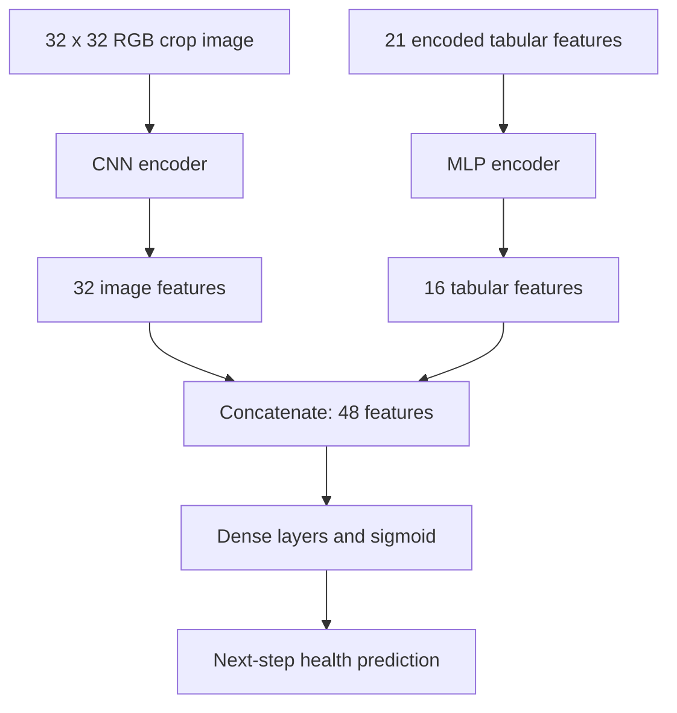

# Multimodal Crop Health Prediction for Smart Greenhouses

A machine learning investigation into next-step crop health forecasting using environmental measurements, planned greenhouse actions and synthetic crop imagery. Originally developed for COMP3032 Machine Learning at Western Sydney University (2026).

## Project overview

The goal is to predict `next_health_score`, a continuous value between 0 and 1, one simulation step ahead. The project compares classical regression with a lightweight multimodal neural network combining tabular and visual information.

- **Part A — Classical ML:** mean baseline, Ridge regression, decision tree and RBF support vector regression; grouped cross-validation, hyperparameter search and feature ablation.
- **Part B — Deep learning:** tabular MLP, image-only CNN and CNN–MLP fusion, with image augmentation, early stopping, seed sensitivity and paired episode-bootstrap evaluation.

## Dataset and evaluation

The supplied synthetic dataset has 210 greenhouse episodes, 12,600 raw observations and matching 32 × 32 RGB images. After removing terminal rows without a next-step target, 10,620 observations from 180 episodes are available for training and 1,770 observations from 30 episodes for final evaluation. Splits keep whole episodes together to prevent leakage. Part B reuses Part A's final benchmark, so it is not a fresh blind test set.

The final model uses 12 raw tabular inputs (21 encoded values) and a crop image. Future variables and latent health and disease values are excluded from predictors.

## Results

Reported results on the common 30-episode benchmark (lower RMSE and MAE are better):

| Model | RMSE | MAE | R² |
| --- | ---: | ---: | ---: |
| Mean baseline | 0.093908 | 0.076988 | -0.0003 |
| Decision tree | 0.055255 | 0.041652 | 0.6537 |
| Tabular + RGB Ridge | 0.064739 | 0.051393 | 0.5246 |
| Tabular MLP | 0.053579 | 0.040982 | 0.6744 |
| Image CNN | 0.065599 | 0.050010 | 0.5119 |
| **CNN–MLP fusion + flips** | **0.050909** | **0.038523** | **0.7060** |

The decision tree reduces RMSE by 41.2% compared with the mean baseline. The selected fusion model improves RMSE by a further 7.9% relative to the tree and contains 8,865 trainable parameters. On this synthetic benchmark, combining images and tabular information is more effective than either modality alone. The small improvement due specifically to image flips is not strong evidence of an augmentation benefit.

## Fusion architecture



## Notebooks

- [01 — Classical machine learning](01_classical_ml.ipynb)
- [02 — Multimodal deep learning](02_multimodal_deep_learning.ipynb)

Both original notebooks include saved outputs, figures and model evaluation. They can be inspected without retraining. The implementation uses Python, scikit-learn, PyTorch, pandas, NumPy and Matplotlib.

## Run locally

Python 3.12 is recommended. From the repository directory:

```bash
python3 -m venv .venv
source .venv/bin/activate
python -m pip install -r requirements.txt
jupyter notebook
```

The university-supplied dataset is not distributed with this repository. If you have authorised access to it, place `COMP3032_greenhouse_dataset.zip` (rename the downloaded ZIP to this exact name if needed) beside the notebooks, or set `DATA_LOCATION` in each notebook to the appropriate ZIP or extracted directory. Restart the kernel and run all cells in order. The original notebooks were run with Python 3.12, scikit-learn 1.8.0, NumPy 2.3.5, pandas 2.2.3 and Matplotlib 3.10.8; Part B records PyTorch 2.14.1+cpu. The dependency file uses compatible minimum versions, not a locked reproduction environment. No GPU is required. Results above are the original reported results, not a new reproduction run.

## Limitations

- Synthetic crop images and sensor readings do not establish performance in real greenhouses.
- Predictions tend to overestimate health for low-health crops; the model is not a validated crop-stress alarm.
- Forecasting under logged actions does not establish causal treatment effects.
- The reused benchmark is not a new independent test set for Part B.

## Acknowledgements

Dataset and project brief supplied by COMP3032 Machine Learning, Western Sydney University. The raw dataset and assignment brief are not included. The original academic notebooks are retained with their saved outputs.
